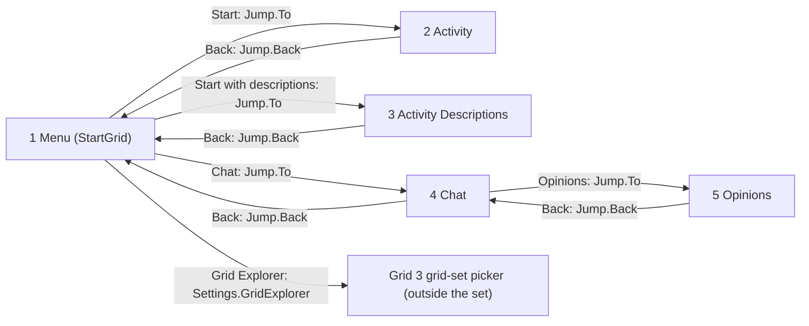
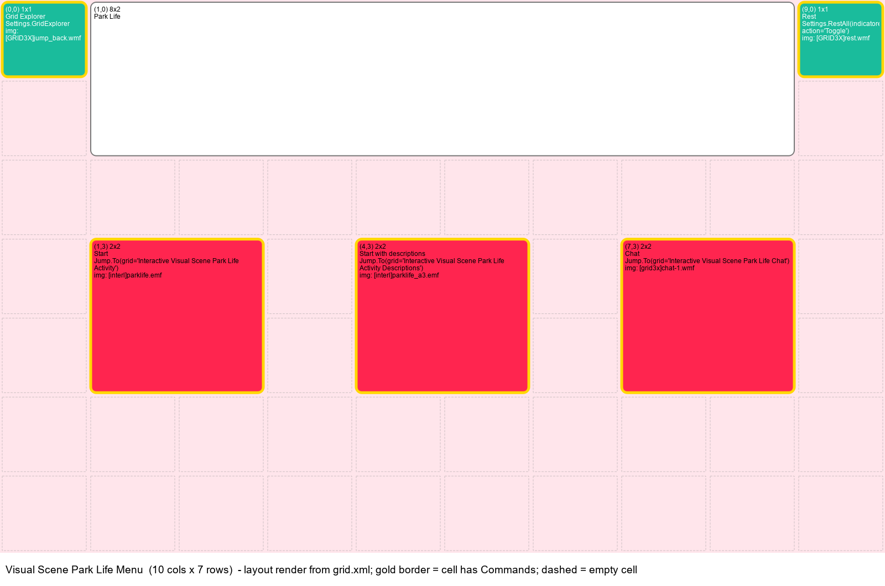
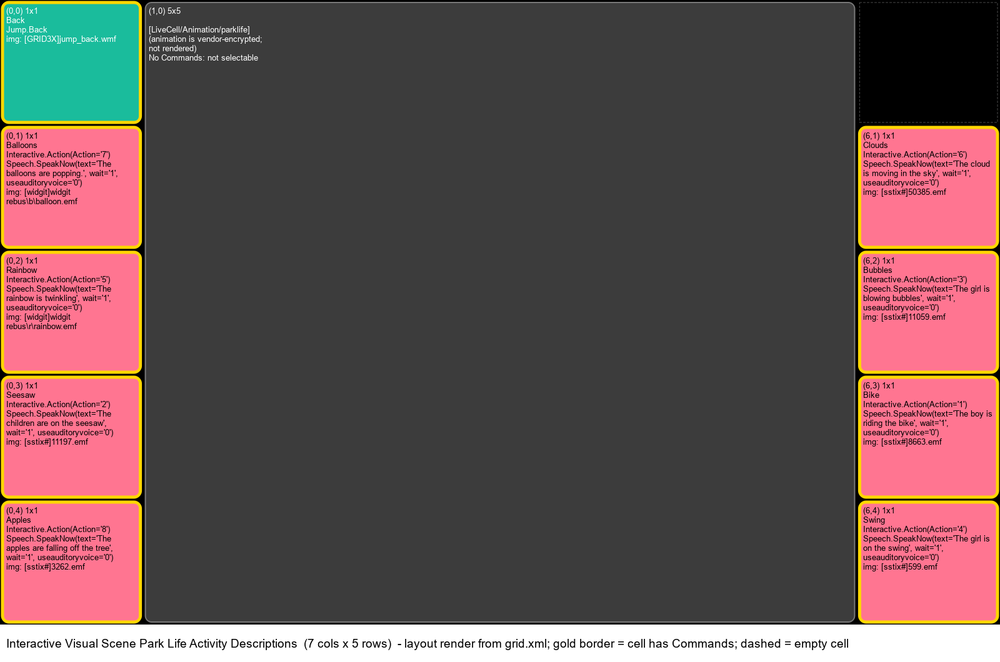
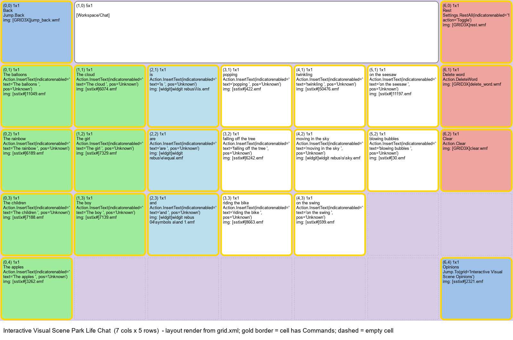
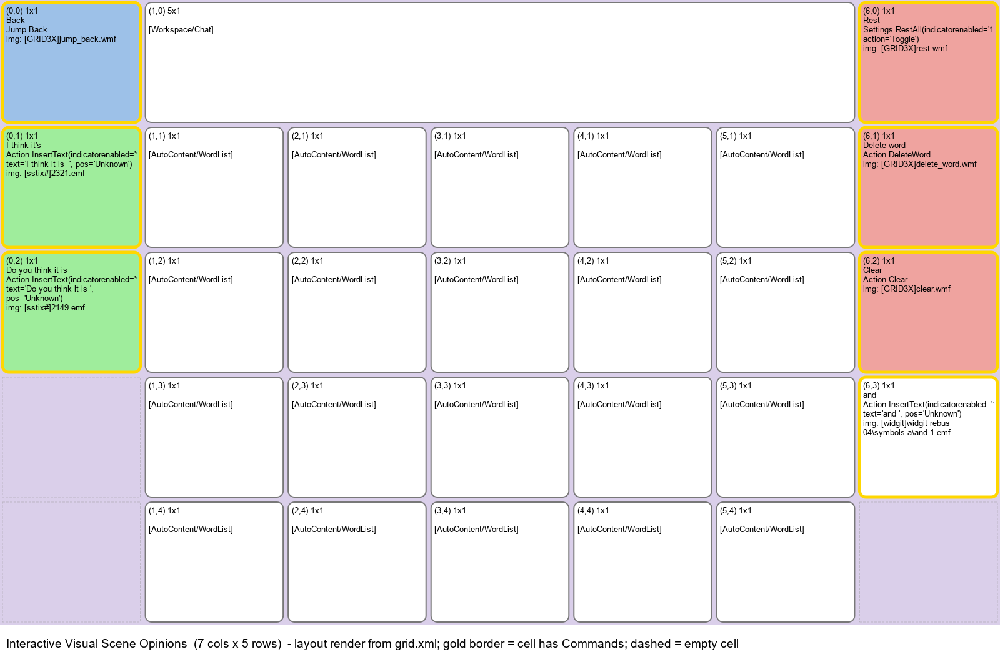

# Grid 3 grid set "Park Life": offline analysis

Reference for agents who will design a new test candidate for the
peds-eye-gaze-assessment app. This file only describes Park Life. It does not
design the new test.

- **Source file (read only):** `C:\Users\Public\Documents\Smartbox\Grid 3\Users\wtmh2\Grid Sets\Park Life.gridset`
  (8,408 bytes, modified 2026-10-10 14:04, sha256 starts `01e5610f91c208e2`).
- **Method:** the gridset was copied and unzipped in a scratch folder and its XML was parsed with Python.
  Grid 3 was not launched. The animation package was looked up read-only in the
  installed symbol library `C:\Program Files (x86)\Smartbox\Grid 3\Resources\Symbols\interl.symbols`
  (also a zip).
- **Analysed:** 2026-10-10.
- Sections 1 to 7 are **FACTS** taken from the files. Section 8 is **INTERPRETATION**.
  Section 9 holds **FACTS** from a live walk-through in Grid 3 (2026-10-10), which also
  corrects parts of section 8.

## Contents of this folder

| Path | What it is |
|---|---|
| `README.md` | This document |
| `assets/xml/settings.xml`, `assets/xml/styles.xml` | Raw grid-set settings and styles (copied unchanged) |
| `assets/xml/1-menu.grid.xml` ... `5-opinions.grid.xml` | Raw `grid.xml` of each page (copied unchanged) |
| `overlays/1-menu.png` ... `5-opinions.png` | Layout renders of each page made from `grid.xml` (see section 6) |
| `live/*.png`, `live/actions/*.png` | Live Grid 3 screenshots, plus a mid-animation frame and a motion map per action (see section 9) |

---

## 1. Key finding first

**Park Life is not a hotspot visual scene.** No page has a background image
with invisible hotspot cells. Instead, the two activity pages have:

- one big **LiveCell** (`<ContentType>LiveCell</ContentType>`,
  `<ContentSubType>Animation</ContentSubType>`, `<ContentSubSubType>parklife</ContentSubSubType>`)
  that spans 5 x 5 cells in the middle (5 of 7 columns, all 5 rows), and
- **8 ordinary buttons** (4 in the left column, 4 in the right column), plus a Back button.

The LiveCell has **no `<Commands>`**, so looking at the scene itself selects
nothing. Each button sends `Interactive.Action` with a number 1 to 8 to the
animation, which then plays that part of the scene, and the button also speaks
a word or a sentence.

The animation itself is an HTML5 package (`activity.html`, `parklife.js`,
CreateJS, two image atlases, 11 MP3 sounds) inside `interl.symbols`. **All of
those files are encrypted by the vendor** (no PNG/MP3/HTML/EMF header; `file`
reports `data`). They were not decrypted. So the scene picture, the positions
of objects in the scene and the exact animation of each action are **unknown**
from offline data.

## 2. Grid-set metadata (`Settings0/settings.xml`)

| XML element | Value |
|---|---|
| `<StartGrid>` | `Visual Scene Park Life Menu` |
| `<Description>` | "Explore the park scene and play with balloons, bubbles and more. This grid set helps teach cause and effect as well as early language skills. Interactive Learning activities are designed to be motivating and fun while teaching key access skills. The included chat grids enable you to talk about what you have achieved, helping progress towards alternative communication." |
| `<Appearance><Theme>` | `Kids` |
| `<Language>` | `en-US` |
| `<Thumbnail>` | `[interl]parklife.emf` |
| `<ThumbnailBackground>` | `#1ABC9CFF` (teal) |
| `<DocumentationSlug>` | `/interactive-learning` |
| `<PictureSearchKeys>` | `sstix#`, `widgit`, `ssnaps` |
| `<GridSetFileFormatVersion>` | `1` |

- There is **no category element**. The "Visual Scene" category seen in Grid 3
  is not stored in the file. The only hints are the page names ("Visual Scene ...",
  "Interactive Visual Scene ...") and `<DocumentationSlug>/interactive-learning`.
- `Settings0/AutoReplacements/autoreplacements.xml` is empty (`<AutoReplacements />`).

## 3. Page inventory

All `<ColumnDefinition />` and `<RowDefinition />` elements are empty, so every
column and every row has the same size.

| # | Page (`Grids/<name>`) | Cols x Rows | `<BackgroundColour>` | Kind |
|---|---|---|---|---|
| 1 | Visual Scene Park Life Menu | 10 x 7 | `#FFE5EBFF` (pale pink) | Regular grid: menu with 3 big buttons |
| 2 | Interactive Visual Scene Park Life Activity | 7 x 5 | `#000000FF` (black) | Animation LiveCell + 8 action buttons (one-word speech) |
| 3 | Interactive Visual Scene Park Life Activity Descriptions | 7 x 5 | `#000000FF` (black) | Same as page 2, but buttons speak a full sentence |
| 4 | Interactive Visual Scene Park Life Chat | 7 x 5 | `#D7CBE8FF` (lilac) | Regular communication grid with a chat workspace |
| 5 | Interactive Visual Scene Opinions | 7 x 5 | `#DACFEAFF` (lilac) | Regular communication grid with an opinion word list |

No page has a background image. No page has hotspot cells.

## 4. Cells per page

Columns: `X,Y` = 0-based column,row of the top-left cell. `Span` = columns x rows.
Empty decorative cells (only `<BasedOnStyle>Default</BasedOnStyle>`, no caption,
no command) are left out and only counted.

### 4.1 Page 1: Visual Scene Park Life Menu (10 x 7) - start page

Interactive cells: 5. Empty cells: 40.

| X,Y | Span | Caption | Image | Style | Commands |
|---|---|---|---|---|---|
| 0,0 | 1x1 | Grid Explorer | `[GRID3X]jump_back.wmf` | style 1 | `Settings.GridExplorer` |
| 1,0 | 8x2 | Park Life (title) | - | style 3 | (none: decorative title) |
| 9,0 | 1x1 | Rest | `[GRID3X]rest.wmf` | Access category style | `Settings.RestAll(indicatorenabled=1, action=Toggle)` |
| 1,3 | 2x2 | Start | `[interl]parklife.emf` | Navigation category style | `Jump.To(grid=Interactive Visual Scene Park Life Activity)` |
| 4,3 | 2x2 | Start with descriptions | `[interl]parklife_a3.emf` | Navigation category style | `Jump.To(grid=Interactive Visual Scene Park Life Activity Descriptions)` |
| 7,3 | 2x2 | Chat | `[grid3x]chat-1.wmf` | Navigation category style | `Jump.To(grid=Interactive Visual Scene Park Life Chat)` |

The three menu buttons have `<BackColour>#FF254FFF</BackColour>` (red).

### 4.2 Page 2: Interactive Visual Scene Park Life Activity (7 x 5)

Interactive cells: 9 (8 actions + Back). Non-interactive: 1 LiveCell. Empty cells: 1 (`6,0`).

| X,Y | Span | Caption | Image | Commands (in order) |
|---|---|---|---|---|
| 0,0 | 1x1 | Back | `[GRID3X]jump_back.wmf` | `Jump.Back` |
| 1,0 | 5x5 | (LiveCell animation `parklife`) | - | (none) |
| 0,1 | 1x1 | Balloons | `[widgit]widgit rebus\b\balloon.emf` | `Interactive.Action(Action=7)`, `Speech.SpeakNow(text="balloons", wait=1, useauditoryvoice=0)` |
| 0,2 | 1x1 | Rainbow | `[widgit]widgit rebus\r\rainbow.emf` | `Interactive.Action(Action=5)`, `Speech.SpeakNow(text="rainbow ")` |
| 0,3 | 1x1 | Seesaw | `[sstix#]11197.emf` | `Interactive.Action(Action=2)`, `Speech.SpeakNow(text="seesaw")` |
| 0,4 | 1x1 | Apples | `[sstix#]3262.emf` | `Interactive.Action(Action=8)`, `Speech.SpeakNow(text="apples")` |
| 6,1 | 1x1 | Cloud | `[sstix#]6074.emf` | `Interactive.Action(Action=6)`, `Speech.SpeakNow(text="cloud")` |
| 6,2 | 1x1 | Bubbles | `[sstix#]11059.emf` | `Interactive.Action(Action=3)`, `Speech.SpeakNow(text="bubbles")` |
| 6,3 | 1x1 | Bike | `[sstix#]8663.emf` | `Interactive.Action(Action=1)`, `Speech.SpeakNow(text="bike")` |
| 6,4 | 1x1 | Swing | `[sstix#]599.emf` | `Interactive.Action(Action=4)`, `Speech.SpeakNow(text="swing")` |

- Every `Speech.SpeakNow` on pages 2 and 3 has `wait=1` and `useauditoryvoice=0`.
- Action buttons: style `InteractiveLearning category style` with `<BackColour>#FF2852FF</BackColour>` (red), `<FontSize>16</FontSize>`.
- Back: `style 1` (teal `#1ABC9CFF`, font Medrano, shape 9).
- LiveCell: `InteractiveLearning category style` with `<BackColour>#FFFFFF00</BackColour>` (fully transparent).
- Every action cell has `<AudioDescription>Animation action</AudioDescription>`
  (the text read out by auditory scanning).

### 4.3 Page 3: Interactive Visual Scene Park Life Activity Descriptions (7 x 5)

Same layout, same `Interactive.Action` numbers and same images as page 2 (one
exception: Clouds uses `[sstix#]50385.emf` instead of `6074.emf`, and the caption
is "Clouds"). The speech is a sentence. Buttons use `style 4` with
`<BackColour>#FF7591FF</BackColour>` (pink) and white text.

| X,Y | Caption | Action | Spoken text (`Speech.SpeakNow text`) |
|---|---|---|---|
| 0,0 | Back | - | `Jump.Back` |
| 0,1 | Balloons | 7 | "The balloons are popping." |
| 0,2 | Rainbow | 5 | "The rainbow is twinkling" |
| 0,3 | Seesaw | 2 | "The children are on the seesaw" |
| 0,4 | Apples | 8 | "The apples are falling off the tree" |
| 6,1 | Clouds | 6 | "The cloud is moving in the sky" |
| 6,2 | Bubbles | 3 | "The girl is blowing bubbles" |
| 6,3 | Bike | 1 | "The boy is riding the bike" |
| 6,4 | Swing | 4 | "The girl is on the swing" |

LiveCell at `1,0` span 5x5, empty cell at `6,0`, as on page 2.

### 4.4 Page 4: Interactive Visual Scene Park Life Chat (7 x 5)

Interactive cells: 23. Non-interactive: 1 chat workspace. Empty cells: 7.
`Action.InsertText` writes rich text (`
<s><r>` runs, some with an `Image`
attribute) into the workspace; the text below is the joined `<r>` text.

| X,Y | Span | Caption | Image | Commands |
|---|---|---|---|---|
| 0,0 | 1x1 | Back | `[GRID3X]jump_back.wmf` | `Jump.Back` |
| 1,0 | 5x1 | (chat workspace) | - | `<ContentType>Workspace</ContentType>` `<ContentSubType>Chat</ContentSubType>`, no commands |
| 6,0 | 1x1 | Rest | `[GRID3X]rest.wmf` | `Settings.RestAll(indicatorenabled=1, action=Toggle)` |
| 0,1 | 1x1 | The balloons | `[sstix#]11049.emf` | `Action.InsertText("The balloons ")` |
| 1,1 | 1x1 | The cloud | `[sstix#]6074.emf` | `Action.InsertText("The cloud ")` |
| 2,1 | 1x1 | is | `[widgit]widgit rebus\i\is.emf` | `Action.InsertText("is ")` |
| 3,1 | 1x1 | popping | `[sstix#]422.emf` | `Action.InsertText("popping ")` |
| 4,1 | 1x1 | twinkling | `[sstix#]50476.emf` | `Action.InsertText("twinkling ")` |
| 5,1 | 1x1 | on the seesaw | `[sstix#]11197.emf` | `Action.InsertText("on the seesaw ")` |
| 6,1 | 1x1 | Delete word | `[GRID3X]delete_word.wmf` | `Action.DeleteWord` |
| 0,2 | 1x1 | The rainbow | `[sstix#]6189.emf` | `Action.InsertText("The rainbow ")` |
| 1,2 | 1x1 | The girl | `[sstix#]7329.emf` | `Action.InsertText("The girl ")` |
| 2,2 | 1x1 | are | `[widgit]widgit rebus\e\equal.emf` | `Action.InsertText("are ")` |
| 3,2 | 1x1 | falling off the tree | `[sstix#]6242.emf` | `Action.InsertText("falling off the tree ")` |
| 4,2 | 1x1 | moving in the sky | `[widgit]widgit rebus\s\sky.emf` | `Action.InsertText("moving in the sky ")` |
| 5,2 | 1x1 | blowing bubbles | `[sstix#]30.emf` | `Action.InsertText("blowing bubbles ")` |
| 6,2 | 1x1 | Clear | `[GRID3X]clear.wmf` | `Action.Clear` |
| 0,3 | 1x1 | The children | `[sstix#]7188.emf` | `Action.InsertText("The children ")` |
| 1,3 | 1x1 | The boy | `[sstix#]7139.emf` | `Action.InsertText("The boy ")` |
| 2,3 | 1x1 | and | `[widgit]widgit rebus 04\symbols a\and 1.emf` | `Action.InsertText("and ")` |
| 3,3 | 1x1 | riding the bike | `[sstix#]8663.emf` | `Action.InsertText("riding the bike ")` |
| 4,3 | 1x1 | on the swing | `[sstix#]599.emf` | `Action.InsertText("on the swing ")` |
| 0,4 | 1x1 | The apples | `[sstix#]3262.emf` | `Action.InsertText("The apples ")` |
| 6,4 | 1x1 | Opinions | `[sstix#]2321.emf` | `Jump.To(grid=Interactive Visual Scene Opinions)` |

All `Action.InsertText` cells also have `indicatorenabled=1` and `pos=Unknown`.
Styles: subjects `style 5` ("Sentence starter", green `#9FED9CFF`), small words
`style 7` ("Small words", `#BBDEEDFF`), phrases `Vocab cell`, tools
`Actions category style` (`#EFA39FFF`). Note: there is no "swing", "bike" or
"rainbow" verb pair for every subject; the sentence parts are mixed and matched.

### 4.5 Page 5: Interactive Visual Scene Opinions (7 x 5)

Interactive cells: 7 fixed + 20 word-list cells. Empty cells: 3.

| X,Y | Span | Caption | Image | Commands / content |
|---|---|---|---|---|
| 0,0 | 1x1 | Back | `[GRID3X]jump_back.wmf` | `Jump.Back` |
| 1,0 | 5x1 | (chat workspace) | - | `Workspace` / `Chat` |
| 6,0 | 1x1 | Rest | `[GRID3X]rest.wmf` | `Settings.RestAll(indicatorenabled=1, action=Toggle)` |
| 0,1 | 1x1 | I think it's | `[sstix#]2321.emf` | `Action.InsertText("I think it is  ")` |
| 0,2 | 1x1 | Do you think it is | `[sstix#]2149.emf` | `Action.InsertText("Do you think it is ")` |
| 6,1 | 1x1 | Delete word | `[GRID3X]delete_word.wmf` | `Action.DeleteWord` |
| 6,2 | 1x1 | Clear | `[GRID3X]clear.wmf` | `Action.Clear` |
| 6,3 | 1x1 | and | `[widgit]widgit rebus 04\symbols a\and 1.emf` | `Action.InsertText("and ")` |
| 1..5, 1..4 | 20 cells of 1x1 | (filled from the word list) | - | `<ContentType>AutoContent</ContentType>` `<ContentSubType>WordList</ContentSubType>`, style `Vocab cell` |

The page has `<AutoContentCommands>` with `AutoContent.Activate(autocontenttype=WordList)`.
`<WordList><Items>` holds 12 words, each with an `[sstix#]` image:
amazing (2532), awesome (2544), boring (2566), cool (2597), crazy (2604),
funny (312), great (2689), gross (2914), OK (2278), bad (2913), garbage (4510),
terrible (52917). So 12 of the 20 word-list cells are filled.

## 5. Navigation graph

- Start page: `<StartGrid>Visual Scene Park Life Menu</StartGrid>`.
- Return: every page except the menu has a `Jump.Back` cell at `0,0` (top-left).
  `Jump.Back` goes to the previous page in history, so the arrows above assume
  the normal path. The menu leaves the set through `Settings.GridExplorer`.
- There is no direct link between the activity pages and the chat pages. The
  user goes back to the menu first.
- Pages 1, 4 and 5 have a `Rest` toggle (`Settings.RestAll`, top-right);
  pages 2 and 3 do not.

## 6. Layout renders (`overlays/`)

Pillow is **not installed** in `dev/.venv`, so the renders were drawn with
PySide6 `QPainter` (offscreen) from `grid.xml`. They are **layout renders, not
screenshots**: there is no background image to draw on, the symbol pictures
(`.emf`/`.wmf` in encrypted libraries) are not drawn, and the LiveCell is a grey
box. Gold border = cell has Commands; dashed outline = empty cell. Each box shows
`(X,Y) span`, caption, commands and image reference.

| Page | Render |
|---|---|
| 1 Menu |  |
| 2 Activity |  |
| 3 Activity Descriptions |  |
| 4 Chat |  |
| 5 Opinions |  |

## 7. Access settings and media

### 7.1 Access / gaze settings

- **The gridset holds no access settings.** `settings.xml` and `styles.xml`
  have no dwell time, selection method, hover/highlight style, scan settings or
  auto-speak element. Speech on selection comes only from the per-cell
  `Speech.SpeakNow` commands (and `Action.InsertText` into the chat workspace).
- Gaze-relevant per-cell items found: `<AudioDescription>Animation action</AudioDescription>`
  on the 16 action buttons (used by auditory scanning), and `indicatorenabled=1`
  on `Settings.RestAll` and `Action.InsertText`.
- Grid 3 stores access settings per **user**, not per grid set. In
  `Users\wtmh2\UserSettings\UserSettings.xml` (read only) the `<AccessSettings>`
  block contains only: `<PointerAccessMethod><IsEnabled>1`, `<TouchAccessMethod><IsEnabled>1`,
  `<GroupScanningAccessMethod>` with `<HighlightStyle>ProgressAndBorder</HighlightStyle>` and `<IsEnabled>1`,
  and `<SwitchSettings><AcceptOnSwitchPress>1`. There is **no eye-gaze access
  method element and no dwell time** in that file, so the user runs on Grid 3
  defaults for anything not listed. The default values are not in any file read here.
- Styles: `BackgroundShape` values used are `1` and `9` (meaning not documented
  in the file). Fonts: Medrano (styles 1-3, Access), default elsewhere.
  Title style 3 uses `<FontSize>96</FontSize>`.

### 7.2 Media

**The gridset zip contains no media at all** (only the 8 XML files listed below).
Every picture is a reference to a Grid 3 symbol library: `[interl]` (Interactive
Learning), `[widgit]`, `[sstix#]` (SymbolStix), `[GRID3X]`/`[grid3x]` (Grid 3 UI icons).

| Zip entry | Bytes |
|---|---|
| `Settings0/settings.xml` | 1,173 |
| `Settings0/AutoReplacements/autoreplacements.xml` | 131 |
| `Settings0/Styles/styles.xml` | 3,486 |
| `Grids/Visual Scene Park Life Menu/grid.xml` | 9,991 |
| `Grids/Interactive Visual Scene Park Life Activity/grid.xml` | 8,440 |
| `Grids/Interactive Visual Scene Park Life Activity Descriptions/grid.xml` | 8,745 |
| `Grids/Interactive Visual Scene Park Life Chat/grid.xml` | 22,877 |
| `Grids/Interactive Visual Scene Opinions/grid.xml` | 15,613 |

The animation package found in `interl.symbols` (1,383 entries in that library).
All files below are **encrypted**; resolution and duration could not be read.

| Entry in `interl.symbols` | Bytes |
|---|---|
| `media/animations/parklife/activity.html` | 1,392 |
| `media/animations/parklife/parklife.js` | 34,992 |
| `media/animations/parklife/createjs-2015.11.26.min.js` | 49,808 |
| `media/animations/parklife/images/parklife_atlas_.png` | 563,232 |
| `media/animations/parklife/images/parklife_atlas_2.png` | 653,568 |
| `media/animations/parklife/images/_preloader.gif` | 1,024 |
| `media/animations/parklife/sounds/applefall_1.mp3` ... `applefall_5.mp3` | 18,480 / 10,848 / 9,280 / 11,616 / 11,744 |
| `media/animations/parklife/sounds/balloonpop.mp3` | 1,824 |
| `media/animations/parklife/sounds/bikebell.mp3` | 31,648 |
| `media/animations/parklife/sounds/bubblegirl.mp3` | 41,520 |
| `media/animations/parklife/sounds/magic.mp3` | 40,656 |
| `media/animations/parklife/sounds/seesawcreak.mp3` | 35,968 |
| `media/animations/parklife/sounds/swoosh.mp3` | 26,048 |
| `symbols/parklife.emf` (menu "Start" picture + set thumbnail) | 15,952 |
| `symbols/parklife_a1.emf` ... `parklife_a8.emf` (`a3` = "Start with descriptions" picture) | 15,952 / 15,040 / 9,600 / 9,760 / 672 / 1,840 / 3,056 / 8,224 |

Totals: 0 media in the gridset; 1 HTML + 2 JS + 3 images + 11 sounds + 9 EMF
symbols in the vendor animation package (26 files, all encrypted). Because of
the encryption, `assets/` holds only the raw XML; no images were copied.

---

## 8. INTERPRETATION (not facts)

Everything in this section is an opinion drawn from the facts above. A live
walk-through of Grid 3 can confirm or correct it.

### 8.1 What skill it exercises

- **Cause and effect** first: select a button, something happens in the scene
  plus speech. The set's own `<Description>` says "teach cause and effect as
  well as early language skills" and "key access skills".
- **Targeting / dwell selection** of fixed, large buttons at the screen edges.
- **Free choice / exploration**: 8 effects, any order, no prompt. It is not
  scene exploration by gaze, because the scene has no hotspots. The child looks
  *away* from the scene (to the side buttons) to make something happen, then
  looks *back* at the scene to see it.
- **Language**: page 2 labels the object with one word; page 3 models a full
  sentence; pages 4 and 5 let the child build "The girl is blowing bubbles" or
  "I think it is funny" to talk about it afterwards (a progression toward AAC).

### 8.2 Targets: count and size

- 8 effect targets + 1 Back on each activity page; nothing else is selectable.
- With equal rows and columns, one button is 1/7 of the grid width and 1/5 of
  its height. On a 1920 x 1080 full-screen grid (ignoring Grid 3 margins and
  bars) that is about 274 x 216 px per button. The scene is 5/7 of the width
  (about 71 %) and the full height.
- The buttons sit in two columns at the far left and far right edges. Each
  pair of buttons in a row is about 1,650 px apart.

### 8.3 Feedback on selection

- Auditory: spoken word (page 2) or sentence (page 3), with `wait=1`
  (probably waits for the speech to finish before the next command or input).
- Visual: the animation in the scene. The sound file names suggest which
  sound goes with which action: applefall (Apples, 5 variants), balloonpop
  (Balloons), bikebell (Bike), bubblegirl (Bubbles), seesawcreak (Seesaw),
  magic (Rainbow "twinkling"), swoosh (Cloud "moving" or Swing). The mapping
  of action number to animation is only known from the button captions.
- The dwell/hover indicator itself comes from the user's Grid 3 access
  settings, not from this set.

### 8.4 Success, scoring, progression

- **No success criterion, score, counter, timer, trial structure or error
  state** exists in the files. Every selection is "right". There is no target
  prompt ("find the bike"), so there is nothing to get wrong.
- Progression is by the *menu*, chosen by the adult: single words -> sentences
  -> chat / opinions. It is not automatic.
- The `Interactive.Action` numbers on the buttons do not follow screen order
  (left column 7, 5, 2, 8; right column 6, 3, 1, 4). Nothing in the files
  suggests that matters to the child.

### 8.5 How it differs from the app's 4 existing tasks

The app's tasks (`src/engine/task_runner.py` `TASK_REGISTRY`, names from
`src/engine/task_info.py`):

| App task (id) | What it does | Park Life difference |
|---|---|---|
| Static Click (`click_static`) | One still target on an empty field; look and select | Park Life always shows 8 targets at once, all valid, on a busy animated layout; no "the" target |
| Grid Click (`click_grid`) | One cell of a board lights up; select the lit cell | Park Life cues nothing; the child picks freely, so there is no hit/miss |
| Follow the Target (`follow_moving`) | Target moves; child follows, nothing selected | Park Life targets never move; the moving thing is the scene effect *after* selection, and it is not measured |
| Scanning Search (`scanning`) | Find the cued shape among others | Park Life has no cue and no distractors; every button is a target |

Main differences in one list:

1. **Open choice, not a prompted trial.** No correct answer, so the existing
   hit / miss / timeout model does not apply as is.
2. **Reward is contingent on the selection**, and it is large and multi-modal
   (animation + speech + sound effect). The app's existing feedback is a short
   hit/miss sound and a glow.
3. **Split attention**: targets at the screen edges, effect in the centre. The
   gaze has to go out to a button and come back to the scene.
4. **Language layer** (word, sentence, chat) on top of access. The app has none.
5. **Engagement and motivation** are the goal, not measured accuracy or
   reaction time.

### 8.6 What could not be decoded

- The scene picture, object positions, animation timing and sounds: the
  `parklife` package in `interl.symbols` is encrypted. Not decrypted on
  purpose.
- What each `Interactive.Action` number does inside the animation (only the
  button captions and spoken text tell us).
- The symbol pictures (`[sstix#]`, `[widgit]`, `[interl]`, `[GRID3X]`).
- Default dwell time and hover feedback for this user (not stored in any file).
- The meaning of `BackgroundShape` values `1` and `9`, and whether `wait=1`
  blocks input.

---

## 9. LIVE walk-through (2026-10-10, FACTS)

- **How:** Grid 3 3.0.93 (evaluation copy) was launched and driven with WinApp MCP from an
  elevated Claude Code session: user wtmh2, Grid Explorer page 2, folder "Visual scenes",
  then Park Life. Window 1920 x 1080 at 100 % scaling. Access was pointer (mouse) clicks
  on UIA `Cell (X,Y)` elements.
- **Motion capture:** for each action, the scene area (screen x 330-1592, y 88-1023) was
  captured every ~0.49 s while the button was clicked. Frame-to-frame pixel differences
  give the moving region and duration. Durations are **±0.5 s**.
- **Not captured:** audio. The speech and sound effects were played but not recorded, so
  the spoken text below still comes from the XML (section 4).
- **Files:** page screenshots in `live/` (`01-menu.png` ... `05-opinions.png`, plus
  `00-grid-explorer.png` and `00b-visual-scenes.png`). For each action, `live/actions/<n>-<name>-frame.png`
  (mid-animation) and `<n>-<name>-motion.png` (red = pixels that changed during the burst).

### 9.1 Cross-check with the offline facts

- **Confirmed:** all 5 pages, their titles, cell positions, captions, colours, the 5 x 5
  LiveCell, `Jump.Back` routes, the 12-word Opinions list (filled **row by row**, 8 empty
  cells), and Clouds-vs-Cloud on page 3. The UIA `Cell (X,Y)` ids match the `grid.xml` X,Y values.
- **Same animation on pages 2 and 3:** Balloons was re-run on page 3 with the same motion
  region and length. Only the buttons (pink) and the speech differ.
- **The LiveCell is one still picture plus animated parts.** It is not a video. Between
  actions it stays still except for **idle eye blinks** (bike boy, bench girl, bubbles
  girl), about 150-700 px each, every few seconds.
- **Every action resets itself:** popped balloons and fallen apples grow back, and the
  cloud and the bike return to where they started. After each action the scene is the
  same as the idle picture (`02-activity-idle.png`).
- **Hover feedback:** the cell under the pointer gets a thick orange rounded ring
  (`04-chat.png`, "popping"). After a click the ring stays as long as the pointer stays on the cell.
- **Chat workspace:** shows symbol-supported text (a symbol above "balloons", "are",
  "popping"; none above "The"). The UIA Name of `Cell (1,0)` is the workspace text
  ("The balloons are popping ").

### 9.2 Scene objects (fractions of the scene: x left to right, y top to bottom)

| Object | x | y | Linked button (action) |
|---|---|---|---|
| Cloud | 0.43-0.83 | 0.00-0.14 | Cloud / Clouds (6) |
| Rainbow | 0.45-0.77 | 0.12-0.36 | Rainbow (5) |
| Balloon bunch (string tied to the bench) | 0.79-0.99 | 0.03-0.28 | Balloons (7) |
| Apple tree, 10 apples in the crown | 0.05-0.45 | 0.08-0.72 | Apples (8) |
| Two children on the seesaw | 0.51-0.74 | 0.33-0.52 | Seesaw (2) |
| Boy on the bike, on the path | 0.36-0.47 | 0.42-0.63 | Bike (1) |
| Girl on the swing (front left, large) | 0.00-0.29 | 0.51-0.97 | Swing (4) |
| Girl with bubble bottle (front centre) | 0.47-0.59 | 0.65-0.95 | Bubbles (3) |
| Girl on the bench | 0.71-0.95 | 0.50-0.75 | none (decoration) |

### 9.3 What each action does

| Button (action) | What animates | Motion region x / y | Duration |
|---|---|---|---|
| Bike (1) | Boy rides right along the path, leaves behind the bush on the right, comes back in from the left and stops at his start point | 0.25-0.83 / 0.43-0.76 | ~4 s |
| Seesaw (2) | The plank tilts up and down a few times with both children on it | 0.42-0.83 / 0.34-0.76 | ~2 s |
| Bubbles (3) | Girl lifts the wand and blows; bubbles float up and to the left toward the bike | 0.41-0.61 / 0.44-0.92 | ~4 s |
| Swing (4) | Girl swings forward and back | 0.00-0.31 / 0.57-0.95 | ~2.5 s |
| Rainbow (5) | The colour bands cycle ("twinkle"); the rainbow does not move | 0.47-0.74 / 0.13-0.33 | ~1.5-2 s |
| Cloud (6) | The cloud drifts out of the scene to the left, comes back in from the right, and settles where it started | 0.08-1.00 / 0.00-0.13 | ~3.5 s |
| Balloons (7) | The balloons pop one after another (white burst), bare strings stay, then the balloons fade back in | 0.80-1.00 / 0.04-0.39 | ~3.5 s |
| Apples (8) | The apples drop to the ground under the tree, then new apples appear in the crown | 0.14-0.52 / 0.14-0.79 | ~4.5 s |

- **Each effect is local:** every action moves only its own object. Only Bike and
  Cloud cross a large part of the scene.
- **Not tested:** pressing a second button while an animation is still running, a
  repeated press, and whether `wait=1` blocks input during the speech.

### 9.4 Corrections to section 8

- 8.6 "scene picture, object positions, animation timing": now known (9.2, 9.3).
  The sounds are still unknown.
- 8.3: the action-to-animation mapping is now confirmed live. It matches the button
  captions and the page 3 sentences.
- 8.1 / 8.5 "split attention": confirmed, and the layout makes it stronger. The
  buttons are **not** placed next to their objects. The Balloons button is in the far-left
  column, but the balloons are top right. The Swing button is in the far-right column,
  but the swing girl is bottom left. Apples (left button, tree on the left) is the only
  close pair.
